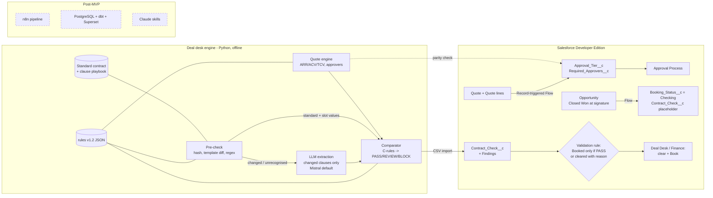

# Architecture

Two flows that share one rules file. Automation/AI logic is kept apart from analytics/reporting.
MVP: the engine runs offline and hands results to Salesforce by CSV. Dashed boxes are post-MVP.

## Why this split
- **Approvals live in Salesforce** (Approval Process + Flow) because it's native, auditable and what admins maintain. Python computes the same approver list for testing; the parity check proves they agree.
- **The gate is on Booking Status, not Stage** (DEC-10). Closed Won happens at signature; the check runs on the signed contract and gates booking.
- **The contract check lives outside Salesforce** because text comparison and LLM calls don't belong in Flow, and the engine must be testable offline.
- **Deterministic before AI.** Hash and diff recognise standard and approved-variant clauses; regex reads numbers and dates. The LLM only sees what's left, so cost stays near zero and results are repeatable.
- **The LLM sits behind a schema.** The comparator never reads raw LLM prose, so a hallucinated clause can't change a decision without an unverifiable snippet, which itself raises C-19.

## Environments and cost
| Component | Choice | Cost | Phase |
|---|---|---|---|
| CRM | Salesforce Developer Edition | Free | MVP |
| Engine | Python, pydantic, pytest | Free | MVP |
| LLM | Mistral low-cost model via API (EU), one comparison model | A few cents for the whole test set | MVP |
| Orchestration | n8n self-hosted (Docker) | Free | Post-MVP |
| Analytics | PostgreSQL + dbt-postgres + Superset (Docker) | Free | Post-MVP |
| Interactive path | Claude skills | Included in the plan | Post-MVP |

## Security and privacy
- Secrets only in `.env`; `.env` is in `.gitignore`.
- Synthetic data only. For real use: document the LLM provider's retention policy and processing region, send only changed clause text (never Account notes or whole contracts when not needed), and keep contract files 7 years for audit or under the company retention policy.
- Salesforce permission sets restrict who can clear a check or set Booked.
