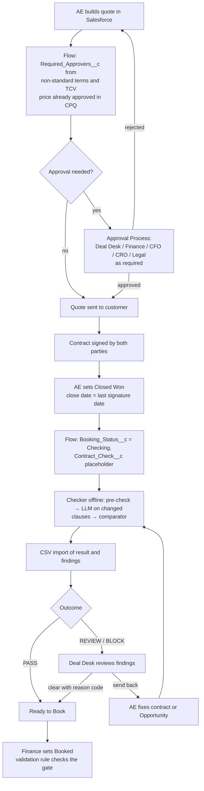

# DD-001 — Scope & governance

## Purpose
Define what the Deal Desk & Contract-to-Booking Check covers in the MVP, who uses it, which decisions it makes, and which it never makes. Every later card builds on this one.

## Story
MoP Cloud sells platform subscriptions plus usage-based compute credits to research organisations in Spain, Portugal and France. Deal volume and complexity are growing: multi-year deals, step-ups, committed credits and non-standard terms requested by procurement. Today three things go wrong:

1. **Quotes leak margin.** AEs send quotes with discounts or terms nobody approved, because the approval rules live in people's heads.
2. **Approvals are slow.** Nobody knows who has to approve what, so quotes wait in inboxes and deals slip.
3. **Bookings don't match contracts.** The signed contract sometimes differs from the Opportunity: a different start date, an extra opt-out clause, different credits or payment terms. Finance finds this at month-end close, or worse, at renewal. ARR, commissions and revenue schedules end up wrong.

The deal desk fixes these with one written policy, an approval path the system works out automatically, and a check that compares every Closed Won deal with the signed contract before it is booked. The check is deterministic first (hash, template diff, regex). An LLM reads only clauses that changed or that the playbook does not recognise.

## What this card delivers
| # | Deliverable | Where | What it contains |
|---|---|---|---|
| 1 | Scope statement | This card: In scope / Out of scope | The MVP boundary and the deferred list, so every later card can be checked against it |
| 2 | Decision log | This card: Decisions | DEC-01 to DEC-20 with the option chosen and why. New decisions get the next DEC number here |
| 3 | Stakeholder map and RACI | This card: Stakeholders, RACI | Who needs what, and who is Responsible / Accountable / Consulted / Informed at each step |
| 4 | To-be process map | This card: Process map | The quote-to-booking flow the MVP implements, with the system steps and the human steps |
| 5 | Glossary | This card: Glossary | Each term links to its definition in DD-002, so there is one definition per term |
| 6 | Data protection note | This card: Data protection | What personal data is involved, where it is processed, what is sent to the LLM, and retention |
| 7 | Definition of done | This card: Definition of done | The checks every card must pass before its issue is closed |
| 8 | Repo and tracking | GitHub | Public repo `deal-desk-check`, one issue per card on the project board |

## Stakeholders
| Role | Needs | Uses |
|---|---|---|
| Account Executive (AE) | Fast, predictable approvals; knows upfront what needs approval | Quote approval status in Salesforce |
| Sales Manager / VP Sales | Price and discount approvals happen in CPQ, upstream of this deal desk | Informed of term approvals and booking status |
| Deal Desk (Business Ops Analyst) | One policy, one queue, evidence for every exception | Quote review, contract check results, booking gate |
| Finance / CFO | Bookings that match contracts; correct ARR and commission base | Booking status, check findings |
| Legal | Non-standard clauses routed to them | Approval requests for N-rules |
| Director of RevOps | Quote turnaround, discount trends, booking accuracy | Test report now; dashboard after the MVP |

## RACI
R = does the work · A = owns the outcome (one per row) · C = consulted · I = informed. "System" means the rules engine or a Salesforce Flow; it computes but never approves or books.

| Step | AE | Sales Mgr / VP / CRO | Deal Desk | Finance / CFO | Legal | Director RevOps | System |
|---|---|---|---|---|---|---|---|
| Build and submit the quote | R/A | I | I | | | | Validates Q-rules |
| Work out the approval path | I | I | A | | | | R (N-rules, A-02 to A-04) |
| Review large deals (A-02 CRO, A-03 CFO) | I | R/A (CRO) | C | R/A (CFO) | | | Routes |
| Approve non-standard terms (N-rules) | I | C | R/A for Deal Desk items | R/A for Finance/CFO items | R/A for legal items | | Routes |
| Mark Closed Won at last signature | R | A | I | I | | | Sets Booking Status = Checking |
| Run the contract check | | | A | I | | | R (pre-check, LLM, comparator) |
| Clear a REVIEW or BLOCK, or send back | C | C | R/A | C | C for C-17 | | Logs who, when, reason |
| Book the deal | I | I | C | R/A | | I | Gate enforces PASS or cleared |
| Change the policy (rules version) | C | C | R | C (A for discount bands and payment terms) | C | A | Tests re-run |

## Process map (to-be, MVP)

As-is (for the before/after in DD-013): approvals by email or Slack with no written bands, contracts compared by eye or not at all, mismatches found at month-end close or renewal.

## In scope (MVP)
- New business, expansion (upsell) and renewal quotes for the products in the DD-002 price book.
- Term lengths of 12, 24 and 36 months (longer needs CFO approval), annual step-ups, and committed credits per contract year.
- **Quote review computation** (Python, offline): ARR schedule, ACV, TCV and the approver list from the rules file (DD-004).
- **Contract-to-booking check**: hash → template diff → regex extraction (DD-014) → LLM only for changed or unrecognised clauses (DD-007) → C-rules → PASS / REVIEW / BLOCK (DD-008).
- **Standard contract and clause playbook** with stable clause IDs; synthetic test contracts generated from them (DD-006).
- **Salesforce Developer Edition thin slice** (DD-005): price books, Quote discount approvals, Contract Check object, booking gate, record-triggered Flows. Checker results go in by CSV import.
- **Human booking step**: a named person clears REVIEW/BLOCK with a logged reason and sets Booking Status = Booked.
- **Offline testing** with JSON fixtures, scored by precision and recall per C-rule (05_test_method.md).

## Out of scope (v1)
- n8n orchestration and any Salesforce API integration (deferred, DD-009).
- Booking queue, override UI and Finance export beyond the gate itself (deferred, DD-010).
- dbt / Superset analytics (deferred, DD-011). The MVP reports K-09, K-10 and K-11 from the test report.
- Claude skills packaging (deferred, first add-on after the MVP, DD-012).
- PDF parsing and scanned documents. Contracts are plain text in v1. The C-20 page-sequence check stays; the text-layer check is deferred.
- Generating real contract documents, e-signature integration and redlining.
- Invoicing, revenue recognition (ASC 606 / IFRS 15) and real ERP integration.
- Commission calculation itself (only the booking data it relies on).
- Usage metering of credits (that belongs to the Credit Burn & Renewal Radar).
- Salesforce CPQ / Revenue Cloud, and with it **price and discount approvals**. They happen upstream at the quoting stage; the approved net price arrives with the quote (DEC-15). Standard Quotes are used to hold the data.
- Real customer data of any kind.

## Decisions the system makes vs never makes
| The system decides | A person always decides |
|---|---|
| Which approvals a quote needs (from the A-rules) | Whether to approve |
| Whether a contract matches the booking data (C-checks) | Whether to book, override or send back |
| ARR/ACV/TCV figures from the policy formulas | Changing the policy (versioned rules) |
| Flags for non-standard clauses | Whether a non-standard clause is acceptable |

## Decisions
| ID | Decision | Options | Decided |
|---|---|---|---|
| DEC-01 | Company | Reuse MoP Cloud / new fictional company | **Reuse MoP Cloud**: one end-to-end story with LeadFlow, RLR and MDH |
| DEC-02 | CRM | Real Salesforce Developer Edition / simulated | **Real Developer Edition, thin slice only** (DD-005). JSON fixtures stay the test source |
| DEC-03 | LLM for extraction | Mistral / Claude / provider-agnostic | **Provider-agnostic interface, Mistral by default** (EU processing). One comparison run against one other model on the same changed clauses: accuracy, cost, stability |
| DEC-04 | Booking ARR for step-up deals | Book Year-1 ARR + scheduled step-ups / book average ARR | **Book Year-1 ARR**, with step-ups kept in a contracted ARR schedule (see DD-002 §6) |
| DEC-05 | Committed credits in ARR | Count / don't count | **Count committed credits**; overage and pay-as-you-go never count |
| DEC-06 | Orchestration | n8n / Salesforce Flow only / Python only | **Salesforce Flow + Approval Process** for quote approvals and the booking gate. n8n deferred (DD-009) |
| DEC-07 | Analytics | PostgreSQL + dbt + Superset / Power BI / Snowflake trial | **Deferred** (DD-011). When built: PostgreSQL + dbt + Superset |
| DEC-08 | Repo | `deal-desk-check` (public, MIT) | The owner creates it and runs git/gh locally |
| DEC-09 | Currency | EUR only / EUR + USD | **EUR only** in v1; a USD contract against an EUR quote is a C-check failure |
| DEC-10 | Where the Salesforce gate sits | Block Stage = Closed Won / block Booking_Status__c = Booked | **Block Booked.** Closed Won is set at signature (C-22 needs close date = last signature date); the check runs on the signed contract, then gates booking |
| DEC-11 | Test set size | 20 / 15 / 10 deals | **15**: 12 with exactly one planted error, 3 clean |
| DEC-12 | ID for the deterministic pre-check card | Renumber DD-007+ / new ID | **DD-014**, built before DD-007; no references break |
| DEC-13 | Precision KPI | K-11 in rules v1.1 / test report only | **K-11 in rules v1.1** (finding precision, test set) |
| DEC-14 | Short non-renewal notice | Add "< 60 days" to N-06 in v1.1 / leave the gap | **Add in v1.1**: notice < 60 days → Deal Desk (replaced in v1.2 by segment bands) |
| DEC-15 | Price and discount approvals | Route here / compute only / out of scope | **Out of scope (v1.3).** Owned by CPQ at the quoting stage. This deal desk approves terms, contract language, rebates, volume commitments and deal size (A-02/A-03) |
| DEC-16 | Quote validation severity | Block by owner / block all / block by impact | **Block by impact (v1.4).** Q-01, Q-06, Q-07, Q-08, Q-10 block; CPQ product setup (Q-02 to Q-05, Q-09) warns; discount data checks Q-11 and Q-12 warn and are kept on record with who approved the discount in CPQ |
| DEC-17 | Free months and bonus credits in contract values | ARR at run-rate, TCV invoiced / plus concession value | **ARR at the full yearly rate; TCV and ACV on what is invoiced; free months and bonus credits reported as a separate concession value (v1.4)** |
| DEC-18 | Segment for expansions and renewals without a platform line | Contract amended / account default / require platform line | **The specific contract amended or renewed (v1.4)**, through `amended_contract_ref` / `Amended_Contract__c`, never an account-wide lookup; missing or inactive → Q-10 blocks |
| DEC-19 | DD-006 contract and playbook model | Per decision: A / B / C (see DD-006) | **A for all five:** plain-text contracts with page markers (PDF post-MVP); clause-library IDs in headings; one fixed format per slot type; allowed variants as fixed wording with slots, matched by hash; English with ES / PT / FR governing-law variants |
| DEC-20 | DD-014 pre-check model | Per decision: A / B / C (see DD-014) | **A for all five:** template patterns with typed slot captures (fingerprint kept as evidence); word-level diff; only changed, unrecognised or unreadable clauses go to the LLM; deterministic injection screen before any LLM call (C-21); strict slot parser, unreadable values go to the LLM |

## Glossary
One definition per term, kept in DD-002. This list only points to it.
| Term | Meaning in one line | Definition |
|---|---|---|
| ARR_y / contracted ARR schedule | Net recurring amount for contract year y, at run-rate | DD-002 §6 |
| Booked ARR | ARR_1 for new business; ARR_1 of added lines for expansions | DD-002 §6 |
| Contracted step-up | ARR_y − ARR_(y−1); recorded in the schedule, not a new booking | DD-002 §6 |
| ACV | Recurring amount actually invoiced over the term ÷ term years; one-offs excluded (v1.4) | DD-002 §6 |
| Concession value | Free months at run-rate plus bonus credits at applicable list; reported, never in ARR/ACV/TCV | DD-002 §6 |
| TCV | Net recurring actually invoiced over the term plus one-offs; overage excluded | DD-002 §6 |
| Applicable list | List price after credit tier or academic price, before discount | DD-002 §2 |
| Booking / booking date | Booking Status set to Booked by a named person / the date that happens | DD-002 §6 |
| Close date | Date of the last signature | DD-002 §6 |
| Opt-out | Termination for convenience at an anniversary (N-07) | DD-002 §7 |
| Credit rollover | Unused committed credits carried into the next year (N-08) | DD-002 §7 |
| PASS / REVIEW / BLOCK | Contract check outcomes and their precedence | DD-002 §8 |

## Data protection (GDPR)
- **Personal data in scope:** signatory names and titles, billing contact names and emails, VAT IDs of sole traders. The MVP uses synthetic data only.
- **What goes to the LLM:** only the text of clauses the pre-check marks `changed` or `unrecognised`. Signature blocks, contact details and Account data are never sent. Regex handles those fields locally.
- **Where it is processed:** the engine runs locally. The default LLM is Mistral's API, chosen for EU processing. For real use, confirm the provider's current processing region, retention and training-use terms in its data processing agreement before sending anything.
- **Logs:** raw LLM output and run logs stay local (`logs/`, git-ignored). Only recorded synthetic fixtures are committed.
- **Retention (real use):** signed contracts and check results kept 7 years for audit, or under the company retention policy; LLM request logs kept 30 days.
- **Access:** in Salesforce, only Deal Desk and Finance can see check findings and clear or book; AEs see their own deals.

## Governance
- The policy owner is the Director of RevOps, with the CFO as co-approver for any change to discount bands or payment terms.
- Rules are versioned (`deal_desk_rules_vX.Y.json`). Changes go through a pull request labelled `rule-change` with a change note, and the test set is re-run before merge.
- Every approval and override is logged with who, when, which rule and why.
- Salesforce permissions: AEs see their own quotes; Deal Desk and Finance can clear a check; Finance sets Booking Status = Booked (Deal Desk as named deputy, logged under A-06).
- Progress is tracked as one GitHub issue per card on a GitHub Project board; every change lands through a pull request that references its card.

## Definition of done (every card)
- [ ] Every acceptance criterion on the card is ticked, and the matching GitHub issue checklist matches
- [ ] `pytest -q` passes; any answer-key change is explained in `tests/CHANGES.md`
- [ ] No rule value is changed without a new rules version and a change-log entry
- [ ] The change is merged through a pull request that names the card and closes its issue
- [ ] README status table updated
- [ ] No secrets, tokens or real personal data in the diff

## Success measures (portfolio)
Measured on the synthetic test set. These are not claims about real impact.
- 100% of planted booking-blocking errors caught (K-09 recall); a false-positive BLOCK rate of 10% or less on clean deals (K-10); finding precision reported (K-11).
- Zero LLM calls on clean deals; LLM spend logged per contract.
- Every extracted field carries a source snippet that is verified against the text.
- Approval routing matches the answer key for 100% of test quotes, in Python and in the Salesforce Flow.
- A one-page "how to size the value" note (in DD-013): deals per quarter × error rate × cost per correction, plus hours saved per month-end close.

## Acceptance criteria
- [x] Scope, out of scope and stakeholders agreed
- [x] DEC-01 to DEC-20 decided and recorded here
- [x] RACI reviewed and agreed by the owner (Finance books and owns the booking; Deal Desk clears)
- [ ] To-be process map reviewed; it matches the DD-005 Flows and the DD-008 outcomes
- [x] Glossary terms link to DD-002, with no second definition anywhere else
- [x] Data protection note reviewed (30-day LLM log retention agreed for now)
- [x] Definition of done agreed and copied into the PR template checklist
- [x] Repo `deal-desk-check` created on GitHub with this card as `docs/cards/DD-001_scope.md`
- [ ] GitHub Project board created with one issue per card (`tools/github/setup_project.sh`)

**Proves:** "Has redesigned at least one commercial process end to end… mapped it, documented it" and "keep runbooks, process maps and the tool inventory up to date".
